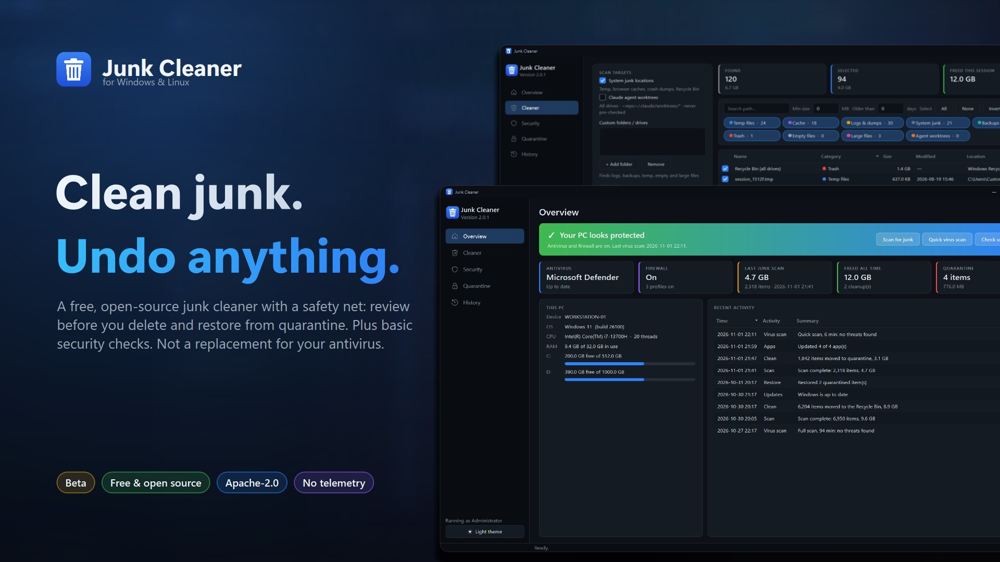
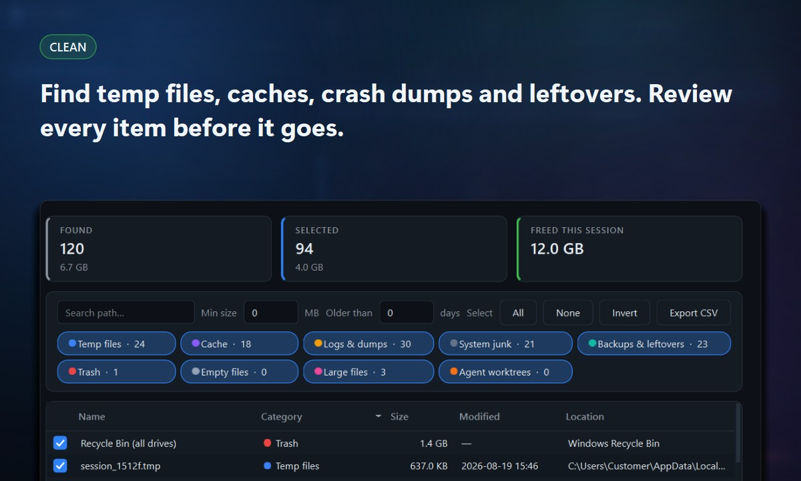
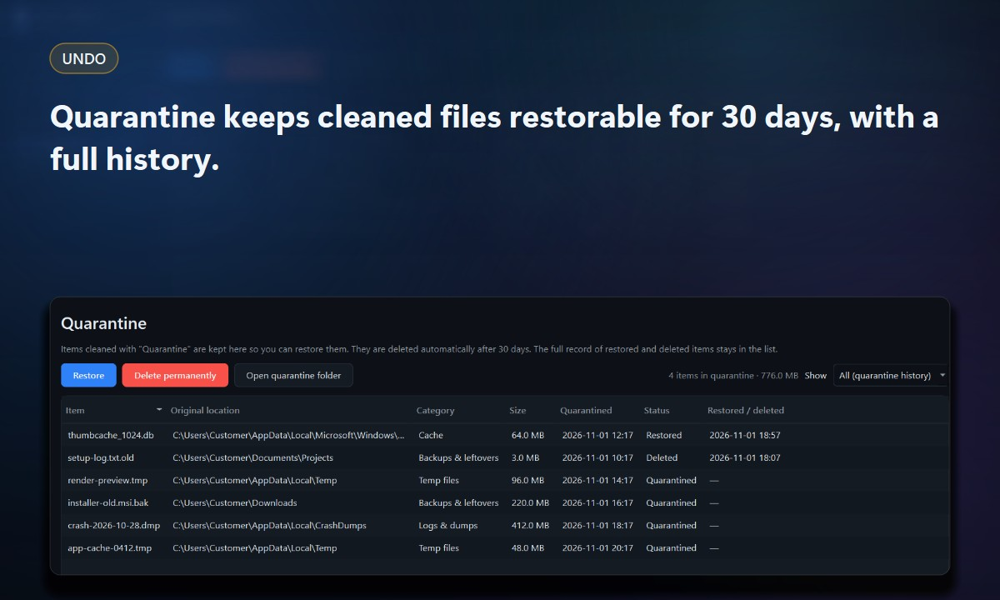
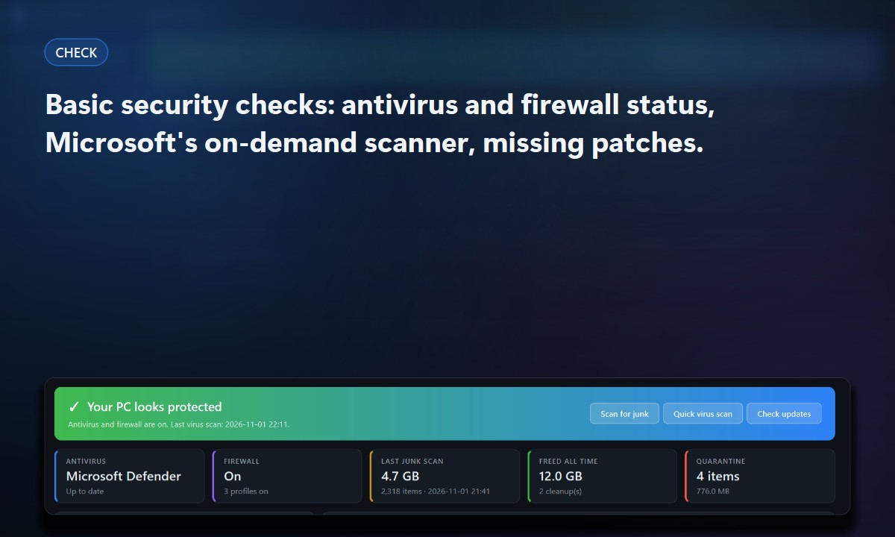
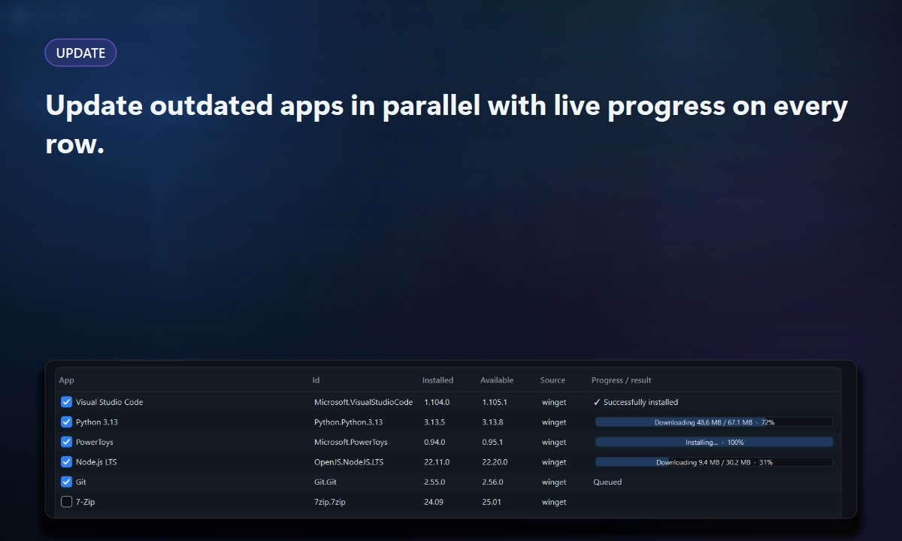
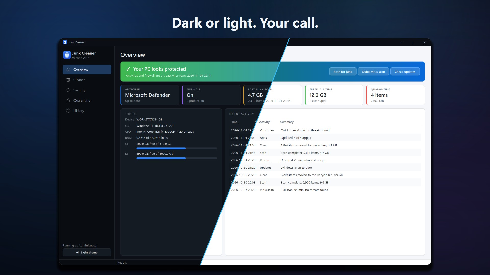

<p align="center">
  
</p>

<p align="center">
  
  <a href="../../releases/latest"></a>
  <a href="../../releases"></a>
  
  
  <br>
  <a href="../../actions/workflows/ci.yml"></a>
  <a href="../../actions/workflows/security.yml"></a>
  
  
</p>

# Junk Cleaner

**A free, open-source junk cleaner for Windows and Linux, with a safety net and a few basic security checks.**
It finds temp files, caches, crash dumps and leftovers, lets you review every item, and keeps what you clean
restorable in a quarantine for 30 days.

> [!IMPORTANT]
> **Beta.** Junk Cleaner is a *cleanup* tool. Its security page offers **basic checks** only (antivirus and
> firewall status, Microsoft's on-demand scanner, missing Windows updates, outdated apps). It is **not** an
> antivirus and does not replace real-time protection. Expect rough edges, and please
> [report them](../../issues/new/choose).

<p align="center">
  <br>
  <sub>Full video: <a href="docs/media/junk-cleaner-30s.mp4">1920×1080 MP4</a> ·
  <a href="docs/media/junk-cleaner-30s-square.mp4">1080×1080 MP4</a></sub>
</p>

## Features

<table>
  <tr>
    <td width="50%"></td>
    <td width="50%"></td>
  </tr>
  <tr>
    <td><b>Clean.</b> System junk locations (temp, browser caches, crash dumps, Recycle Bin / Trash) plus any folders
      you add. Filter by category, size and age. Nothing is removed until you confirm, and the default answer is No.</td>
    <td><b>Undo.</b> Clean to the Recycle Bin, to the app's <b>Quarantine</b> (restore with one click, auto-deleted
      after 30 days) or permanently. Every scan, cleanup and restore is kept in <b>History</b>.</td>
  </tr>
  <tr>
    <td></td>
    <td></td>
  </tr>
  <tr>
    <td><b>Basic security checks</b> (Windows). See which antivirus is active and whether the firewall is on, run
      Microsoft Safety Scanner, read Defender's protection history, and list missing Windows updates with their CVEs.</td>
    <td><b>Update apps.</b> Outdated apps via winget, with checkboxes, parallel updates, live progress on every row,
      and an overall progress bar.</td>
  </tr>
</table>

<p align="center"></p>

### What it is not
- Not an antivirus, firewall or real-time protection. Keep your existing security product.
- No registry "cleaning", no "speed boosters", no scare tactics.
- No telemetry and no account. Network access is limited to Microsoft's scanner download, Windows Update and
  winget. See [SECURITY.md](SECURITY.md).

## Install

**Windows:** download `JunkCleaner-<version>-x64.msi` from [Releases](../../releases), check it against
`SHA256SUMS.txt`, and run it. The installer is not code-signed yet, so SmartScreen may warn ("More info → Run anyway").

**From source (Windows or Linux):**
```bash
python -m venv .venv && . .venv/bin/activate      # Windows: .venv\Scripts\activate
pip install -r requirements.txt
python -m junkcleaner                              # add --no-elevate to skip the UAC prompt
python -m unittest tests.test_core
```

**Build the MSI** (Windows): `pip install pyinstaller`, install WiX v5
(`dotnet tool install -g wix --version 5.0.1` and its UI/Util extensions), then run `./build.ps1`.
The installer lands in `out/`.

## How it works
1. **Scan** is read-only. OS folders (Windows, Program Files, /usr, /etc…) are always skipped, and files changed in
   the last 24 hours are skipped by default.
2. **Review**: safe categories are pre-checked; backups, large files and agent worktrees never are.
3. **Clean** after a confirmation that defaults to No.

App data (history, quarantine, the downloaded scanner) lives in `%LOCALAPPDATA%\JunkCleaner`
(Linux: `~/.local/share/JunkCleaner`).

```
junkcleaner/
  domain.py       model + rules (pure, no I/O)
  platform_os.py  Windows/Linux specifics
  scanner.py      read-only discovery
  cleaner.py      trash / quarantine / delete confirmed items
  quarantine.py   restorable store + its history
  history.py      activity log
  security.py     basic Windows security checks, winget
  ui/             PySide6 pages, dark/light theme
marketing/        screenshot, image and video generators (demo data only)
```

## Contributing
Contributions are welcome. Start with [CONTRIBUTING.md](CONTRIBUTING.md) and look for
[`good first issue`](../../labels/good%20first%20issue).

Every pull request goes through the same pipeline:

| Step | What runs |
| --- | --- |
| **Tests** | Unit tests on Windows and Ubuntu |
| **Security** | Bandit code scan, pip-audit dependency audit, gitleaks secret scan, ClamAV malware scan plus a block on executables or archives in the diff, and CodeQL with dependency review (public repo) |
| **Bot review** | An AI review comments on security, data safety, bugs and missing tests |
| **Human review** | One code-owner approval. Nobody can push to `main` directly. |
| **Auto-merge** | Squash-merges once checks and review pass (maintainer label `automerge`, or Dependabot patch/minor updates) |
| **Release** | After a merge to `main`, the MSI is built, virus-scanned and checksummed. A GitHub Release is published when the version number changes. |

Security problems: please use private reporting as described in [SECURITY.md](SECURITY.md), not a public issue.
Everyone is expected to follow the [Code of Conduct](CODE_OF_CONDUCT.md).

## Roadmap
Planned work is tracked in [issues](../../issues), labelled `feature`, `enhancement` and `quality`.

## Media kit
Images in [`docs/images`](docs/images) (hero, social preview 1280×640, Open Graph 1200×630, billboard 3840×1280,
square post, feature cards, [brand sheet](docs/images/brand-sheet.jpg)) and videos in [`docs/media`](docs/media).
They are generated from code with demo data, so no real machine or user details appear:
```bash
python marketing/capture.py && python marketing/capture.py light   # screenshots with demo data
python marketing/images.py                                         # images  -> docs/images
python marketing/video.py                                          # videos  -> docs/media (needs ffmpeg)
```

## License
[Apache License 2.0](LICENSE), which includes an express patent grant from every contributor. See [NOTICE](NOTICE).

## Contributors
Thanks to everyone who has helped build Junk Cleaner. This list updates automatically when a contributor's first
pull request is merged.

<a href="../../graphs/contributors">
  
</a>
